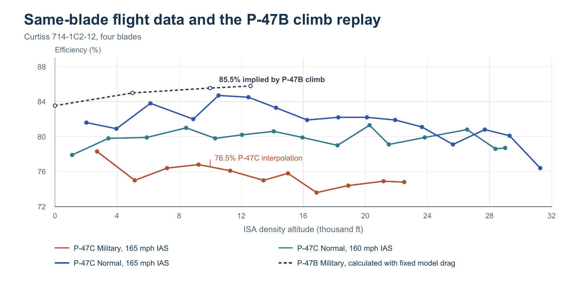

# Fighter Sim Inputs v1.2 · Propeller efficiency

The data release adds 67 readings from two original test programs, 48 source-condition replays and 25 propeller-swap comparisons. An efficiency-only sweep covers seven modeled fighters on simulator **4.9.0-rc.1**, commit `079d955d58425637cffcd84540198dde7f2a0a5d`. The build exposes a separate research companion linked by SHA-256 from the data pack. [Sim input pack](../../references/analysis/fighter-sim-inputs-v1.json) · [Propeller data and results](../../references/analysis/fighter-propeller-efficiency-v1.json) · [Original readings](../../references/research/ww2_propeller_efficiency_2026-11-11.json)

## Original efficiency readings

| Test installation | Operating branch | Points | Reported efficiency span |
| --- | --- | ---: | ---: |
| P-47C, four Curtiss 714-1C2-12 blades | Military, 165 mph IAS, nominal 2,700 engine rpm | 11 | 73.6–78.3% |
| P-47C, same blade | Normal, 160 mph IAS, nominal 2,550 engine rpm | 15 | 77.9–81.3% |
| P-47C, same blade | Normal, 165 mph IAS, nominal 2,550 engine rpm | 16 | 76.4–84.7% |
| P-47D, three Hamilton Standard 6507A-2 blades | Normal and military climb, Table I | 44 | 75.8–80.8% |
| P-47D, same three-blade installation | Selected 2,700 rpm high-speed runs, Table II | 6 | 66.4–85.2% |
| RAE tunnel, two Rotol RA.10046 hydulignum blades | Fixed 22° at 0.7 radius, J = 0.210–0.969 | 25 | 28.6–80.3% |

These are observed spans over different test conditions. The 42 Curtiss climb rows were read from the original Table I image. NACA recorded torque and used slipstream pressure to derive thrust. Run 20-1 reads 77.9% at J = 0.94. The earlier provisional reading of 79.9% at J = 1.00 belongs to run 20-3. The source reports a 5–8% efficiency loss when changing from normal to military power at 165 mph indicated and a 10–11% compressibility loss at Mach 0.7 on the military high-speed branch. [NACA L4L07, pp. 4–6, 10–12 and Figs. 4–6](https://ntrs.nasa.gov/api/citations/19930093302/downloads/19930093302.pdf?attachment=true) · [Retained Table I scan](../../references/import/04_ADDITIONAL_USER_SUPPLIED_FIGURES/NACA_1944_P47C_Table_I_climb_scan_crop.png)

The P-47D's three-blade tests used a slipstream survey. The same report found about a 7% improvement in a reduced-tip-Mach comparison near J = 2.5 and Cp per blade = 0.08. The six retained high-speed readings span tip Mach 0.910–1.084. These results belong to the experimental Hamilton installation. The P-47D-30 research specimen 43-3441 carried the four-blade Curtiss SPA-5. [NACA WR L-594, Tables I–III and conclusions](https://ntrs.nasa.gov/citations/19930093653) · [NACA TN 2899, Table I](https://ntrs.nasa.gov/citations/19930083857)

RAE Table 3 supplies full-scale propulsive thrust and torque for the two-blade wooden test article. The 25 indexed-text rows pass η = J KT / (2π KQ) within 0.005 absolute efficiency. The review entry preserves row 23, which failed that check. The actual BS.543 used four RA.10061 metal blades. The metal Spitfire tunnel report is RAE Aero. 1728 / ARC 9378, catalogued as DSIR 23/15215. Confirm the blade drawing in that file before using its readings for BS.543. [RAE R&M 2357, §§2–3, Table 3 and ref. 3](https://reports.aerade.cranfield.ac.uk/handle/1826.2/3455) · [BS.543 installation audit](../WW2_Three_Comparisons_Primary_Source_Audit_2026-11-06.md) · [DSIR index](https://enginehistory.org/References/UKNA/Prop-DSIR.shtml)

NACA E6K26 covers three- and four-blade Hamilton 6507A-2 configurations. E6J31 covers Curtiss 836-14C2-18R1. These extend evidence on blade loading at high altitude. Their test installations and tunnel corrections set the limits of transfer. P-47D-28 flight tests with a Curtiss 838-1C2-18 test propeller provide a separate comparison at 165 mph IAS as power and RPM rise. Keep those runs with their own blade and RPM metadata. [NACA E6K26](https://ntrs.nasa.gov/citations/20030065899) · [NACA E6J31](https://ntrs.nasa.gov/citations/20030063262) · [NACA 1947 P-47D-28 flight trial](https://ntrs.nasa.gov/citations/20050019331)

## Efficiency implied by the flight data

For a steady source case, divide modeled drag power plus the observed climb's weight-times-vertical-speed power by the test shaft power. Level flight has zero climb power. The calculated result is conditional on the fixed drag, shaft-power basis and atmosphere. Any configuration losses folded into the current drag or useful power stay visible. The 48 replays include calibration cases and related check rows, with their lineage preserved.

| Reference aircraft | Result under matched reported conditions | Use for the next data check |
| --- | --- | --- |
| **P-47B 41-5902** | At 10,000 ft and 196 mph TAS, 2,000 torque-meter BHP and 2,465 ft/min require **85.5%** with the current modeled drag. The P-47C same-blade density interpolation yields **76.5%**. Its source endpoints are 76.1% and 76.8%. | The estimated J, Cp and tip Mach are 1.050, 0.206 and 0.842 versus 1.031, 0.204 and 0.828 in the donor. The donor replay gives **1,992 ft/min** with the current drag. Matching both numbers would require about **180 hp less equivalent drag power** at that state. Audit the combined open-cooling and propulsion losses against a separate drag observation. |
| **P-38G-1 42-12687** | At 5,000 ft and 284 mph TAS the report gives **600 chart BHP per engine**. The current polar requires **629 hp per engine** at 100% efficiency. Six of 13 rows exceed the shaft-power ceiling. | Prioritize the part-power engine chart and clean drag. Raising efficiency alone cannot reconcile those rows. |
| **F4U-4 80765** | At 29,000 ft and 385 kt TAS, the military chart's **1,800 BHP with a ±50 hp reading allowance** gives **88.0–93.1%**, centered at **90.5%**, with the existing clean polar. The current propeller equation gives **81.7%** at that chart state. | This 5.0-point band propagates chart-reading uncertainty only. It is a quantitative starting interval for the high-blower source replay. The sea-level military chart band includes the modeled value. |
| **Spitfire LF IX BS.543** | The +18 psi Table II climb at 10,000 ft requires **92.9%** equivalent useful power with the boost-derived shaft power and fitted climb configuration. | A separate RA.10061 thrust/torque table or installed-power measurement would resolve the shaft, drag and propeller contributions. |
| **P-51B-15 43-24777** | The clean **75 inHg** experimental point at 20,800 ft and 444 mph TAS needs **90.7%** with the Packard chart BHP and test takeoff-weight proxy, versus **86.5%** in the same input replay. | Keep the 75 inHg case separate from the operational 67 inHg rating. The same-blade Mustang IV TK589 gives installation evidence. NACA L4L18 identifies high-speed losses on 43-12105 with power-estimate ambiguity. |

The chart uses the published P-47C density ratios and the P-47B report altitudes in ISA. The dashed P-47B series is the efficiency implied by the observed climb with the current modeled drag.

The **P-47B 41-5942** December 1942 swap tests supply an independent aircraft and a different experiment. In the matched 10,000-ft, 185 mph TAS, 2,000 torque-meter BHP case, the 13 ft Hamilton 6501A-0 installation climbed **280 ft/min** faster than the cuffed Curtiss 714. That is a **5.35 percentage-point equivalent useful-power difference** with common drag as the calculation reference. The Hamilton's gain spans **5.11–5.93 points** across the five matched climb states. The calculation includes any change in installed slipstream drag. The P-40F swap tests carry changes in BHP, TAS and spinner and are preserved as separate original conditions. [P-47B 41-5902 and 41-5942 original Wright Field reports](https://www.wwiiaircraftperformance.com/org/p-47/p-47.html) · [P-38G FS-M-19-1538-A, printed p. 2](https://www.wwiiaircraftperformance.com/org/p-38/p-38_files/P-38G-1_42-12687_FS-M-19-1538-A.pdf) · [F4U-4 VF-96 Plate 3](https://www.wwiiaircraftperformance.com/org/f4u/f4u_files/80765-level.jpg) · [Mustang audit](../P51_PROPELLER_EFFICIENCY_AUDIT.md) · [Swap test data](../../references/research/ww2_multiaxis_propulsion_trials_2026-11-10.json)

## Seven-aircraft sensitivity

The sweep applied 41 relative efficiency factors from 0.80 to 1.20 in 0.01 steps at **63,255 valid baseline states**, for **2,593,455 state-factor evaluations**. It covers **187** Normal and Combat rating-altitude cases from sea level to 40,000 ft at 2,500-ft steps. The other **51** rating-altitude cases are unavailable in the operating replay. At each state the model supplies fixed shaft power, RPM, mass, lift and drag. Conditions are 50% fuel, dry ratings, existing climb cooling for climb and clean for the other metrics. The shaft-power cap activates in **282,680** stress evaluations. The outer factors include settings beyond plausible installed efficiency and are useful for sensitivity only.

At **10,000 ft, Combat dry**, the entries show the nominal result followed by the range from a **±5% relative** efficiency change. Sustained turn uses 200 mph EAS. The acceleration time uses 200→250 mph EAS at fixed mass and initial rating. It is a sensitivity integral over the level acceleration curve. The simulator's timed operational benchmark also tracks fuel burn and rating changes.

| Aircraft | Max level TAS, mph | Best climb, ft/min | 200→250 EAS, sec | Sustained turn, °/s |
| --- | ---: | ---: | ---: | ---: |
| Spitfire LF IX | 380.3 (373.6–386.7) | 4,705 (4,385–5,025) | 14.7 (13.6–16.1) | 15.66 (15.09–16.22) |
| Bf 109 F-4 | 373.5 (366.9–379.9) | 4,763 (4,459–5,067) | 16.0 (14.8–17.5) | 16.57 (15.96–17.16) |
| P-47B | 370.4 (363.5–377.0) | 2,798 (2,563–3,033) | 22.4 (20.5–24.7) | 11.97 (11.49–12.43) |
| P-51B | 408.1 (401.1–414.7) | 4,203 (3,938–4,470) | 16.5 (15.3–17.9) | 15.99 (15.60–15.99) |
| Fw 190 A-4 | 379.6 (372.7–386.1) | 3,569 (3,323–3,815) | 22.6 (20.6–25.1) | 13.00 (12.47–13.50) |
| P-38G | 361.5 (355.0–367.8) | 3,499 (3,269–3,730) | 23.0 (21.1–25.4) | 14.58 (14.01–15.13) |
| F4U-4 | 368.6 (361.8–375.2) | 3,399 (3,167–3,631) | 24.6 (22.5–27.2) | 12.21 (11.73–12.68) |

At this slice the same efficiency change moves max TAS about **6–7 mph each way**. Near nominal, keeping the efficiency contribution alone within the existing **±3 km/h TAS accuracy goal** corresponds to about **±1.36–1.46% relative efficiency** with the other inputs held fixed. That local sensitivity identifies where tighter propulsion evidence could pay off. At 200 mph EAS the P-51B's sustained turn reaches its lift limit, so raising efficiency by 5% has essentially zero effect on that turn result, while it still affects climb and acceleration.

At 10,000 ft the P-51B's level-speed range lies entirely above the P-47B's. At 30,000 ft the nominal values are **429.8 mph for the P-47B** and **416.4 mph for the P-51B**, with a small overlap in the ±5% scenarios. Treat each altitude, rating and speed slice on its own conditions. The first data priority is the P-47B's climb power balance and F4U-4's high-blower point. P-38G part-power data require a paired drag/power check. For the German fighters, W.Nr. 783 Nr. 4 anchors cooling at 2,400 rpm and Me 109 W.Nr. 14003 identifies a VDM 9-12087.10 on a different G-series specimen. Request ARC 9516 / DSIR 23/15353 and exact VDM drawing-specific thrust/torque trials for the F-4, A-4 and G-2. [Fw 190 A-4 Report 783 Nr. 4](https://www.wwiiaircraftperformance.com/org/fw190/a4/fw190-783-nr4.html) · [Me 109 G Report 109 04 L 43](https://www.wwiiaircraftperformance.com/org/me109/g/me109g-14003.html) · [German propeller archive index](https://enginehistory.org/References/UKNA/Prop-DSIR.shtml)

## Coverage and use

| Coverage across 13 variants | v1.1.0 | v1.2.0 | Delta |
| --- | ---: | ---: | ---: |
| Primary | 63.62% | 63.62% | 0 pp |
| With secondary | 64.15% | 64.15% | 0 pp |
| With calculations | 67.15% | 67.15% | 0 pp |
| GOLD | 0/156 | 0/156 | 0 |
| GOLD* | 5/156 | 5/156 | 0 |

The 67 new readings belong to the P-47C and RAE tunnel installations. The replays and stress tests are calculated diagnostics. None supplies a new exact-variant benchmark agreement within the existing rules. Primary source values, calculation ranges and sweep scenarios remain individually traceable. [Coverage and selection rules](WW2_FIGHTER_SIM_INPUTS_V1.md)

- The build pairs `dist/fighter-propeller-efficiency.json` with `dist/research-catalog.json`. Join `primary_series[].observations` and replay observation IDs to the catalog. The P-47B and BS.543 climb cases also link to the existing source-state files.
- For graphs, use measured readings within their own test branches. The RAE tunnel groups use Table 3 rows 1–6, 7–14, 15–22 and 24–26. Draw the calculated replays separately from these measured readings. Display the F4U-4 chart-reading bands only on the corresponding source case.
- Every output array in a sweep case follows `sweep.input.output_factors`. Preserve nulls and the supported rating-altitude domain. Label shaded ±5% or ±20% scenarios with their actual factors. No confidence level is assigned to their widths.
- Reproduce the companion on the pinned simulator inputs with `node validation/diagnostics/fighter_propeller_efficiency.cjs --check`. For every factor, use `node validation/diagnostics/fighter_propeller_efficiency.cjs --full --output <path>`. The input pack's generator checks its link with `node scripts/fighter-sim-inputs.cjs --check`.
